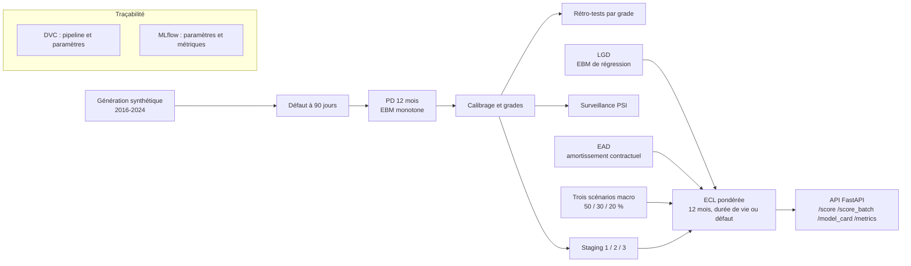

# credit-scoring : provisionnement IFRS 9 expliqué terme à terme

Un pipeline qui calcule la perte de crédit attendue (ECL) d'un portefeuille de prêts, avec une probabilité de défaut que l'on peut lire, contrôler et défendre, sans variable issue des tiers.

## Ce que ça apporte

- **Une PD lisible, sans boîte noire.** Le modèle est une Explainable Boosting Machine : l'API renvoie la contribution exacte de chaque terme, sans SHAP. Des contraintes de monotonie sont posées sur le retard, le ratio de service de la dette et la couverture par garantie. Une contrainte dont le signe contredit la corrélation observée est refusée.
- **Des garde-fous contre la fuite de données, testés.** Embargo de douze mois entre apprentissage et validation, historique et transactions calculés sans le mois courant, découpages temporels disjoints, validation croisée à fenêtre croissante. Chaque règle a son test dans `tests/test_leakage_guards.py`.
- **Une chaîne complète, de la donnée à l'API.** Défaut à 90 jours, PD, calibrage, rétro-tests, LGD, EAD, staging, trois scénarios macro, ECL actualisée, suivi de dérive. Dix étapes DVC, des runs MLflow, une API FastAPI avec métriques Prometheus.

## Le problème

Une banque doit provisionner dès aujourd'hui les pertes qu'elle attend. Prenez un prêt personnel de 500 000 dont le client a 10 jours de retard : faut-il provisionner un an de risque ou toute la durée restante ? La réponse dépend d'une PD non biaisée, d'une LGD, d'une EAD, du stage du prêt et de scénarios macro pondérés. Chaque brique peut se tromper en silence. Une variable qui regarde le futur gonfle les scores. Une variable issue des voisins de transaction pénalise un client pour le défaut d'un tiers. Ce dépôt assemble les briques, rend chaque hypothèse explicite dans `params.yaml` et fait échouer le pipeline quand une règle est violée.

## Démarrer en cinq minutes

Dans un environnement virtuel Python 3.12 ou plus :

```bash
pip install -e ".[dev]"
pytest tests
dvc repro
uvicorn credit_risk_graph.api.main:app --port 8000
curl http://localhost:8000/health
```

Les tests n'ont pas besoin des sorties du pipeline : ils travaillent dans des répertoires temporaires. `dvc repro` génère les données synthétiques puis produit le modèle `artifacts/ifrs9/models/ecl_engine.joblib`, dont l'API a besoin. Sans lui, l'API répond 503 avec la consigne d'exécuter `dvc repro`.

Pour scorer un prêt, `POST /score` attend un objet `features`. Les champs obligatoires sont listés dans `REQUIRED_FIELDS`, dans `src/credit_risk_graph/api/main.py`. La réponse contient la PD à 12 mois, le grade, le stage, l'EAD, la LGD, l'ECL pondérée, l'ECL par scénario et les cinq termes qui pèsent le plus dans la PD.

Le suivi des runs s'ouvre avec `mlflow ui --backend-store-uri sqlite:///mlruns/mlflow.db`. La pile complète (pipeline, API, MLflow, Prometheus, Grafana) se lance avec Docker Compose : `docker compose run --rm pipeline`, puis `GRAFANA_ADMIN_PASSWORD=<mot de passe> docker compose up -d api mlflow prometheus grafana`.

## Comment ça marche



Les étapes DVC dans `dvc.yaml` : `generate`, `tune_ebm`, `train_pd`, `calibrate`, `backtest`, `lgd_ead`, `ecl`, `monitoring`, `figures`, `notebook`.

**Un modèle additif plutôt qu'un boosting opaque.** Un superviseur ou un client doit pouvoir demander pourquoi un score est ce qu'il est. Avec une EBM, la PD est une somme de termes. L'explication locale est donc exacte, pas approchée. LightGBM et la régression logistique restent dans le pipeline comme points de comparaison.

**Les variables de graphe sont calculées, puis exclues.** Le dépôt construit des variables relationnelles avec NetworkX. `fit_pd_model` refuse pourtant tout profil éligible qui en contient. Raison : elles sont calculées sur toute la période d'apprentissage, donc non point-in-time, et elles font porter à un emprunteur le défaut de personnes extérieures au contrat. Le profil `graph_enriched` ne sert qu'au diagnostic. Il n'alimente ni l'ECL ni l'API. Le raisonnement complet est dans [`docs/regulatory_mapping.md`](docs/regulatory_mapping.md).

**Chaque règle de calcul est une fonction testée.** Le staging (retard supérieur à 30 jours, restructuration, hausse significative du risque exigeant un seuil relatif ET un seuil absolu), la PD marginale, l'actualisation au taux d'intérêt effectif, la pondération des scénarios : tout est du code vectorisé avec son test. Les pondérations de scénarios qui ne somment pas à 1 lèvent une erreur.

## Stack

| Domaine | Outils |
|---|---|
| Langage | Python 3.12 ou plus |
| Modélisation | interpret (EBM), scikit-learn, LightGBM, SciPy, NumPy, pandas |
| Graphe | NetworkX |
| Pipeline et suivi | DVC, MLflow |
| API et supervision | FastAPI, Uvicorn, prometheus-client, Prometheus, Grafana |
| Qualité | pytest, ruff, GitHub Actions |
| Conteneurs | Docker, Docker Compose |

## Structure du dépôt

```text
src/credit_risk_graph/
  data/, features/    génération synthétique, nettoyage, variables de graphe
  ifrs9/              défaut, PD, calibrage, backtesting, LGD, EAD, staging, scénarios, ECL
    stages/           une étape DVC par fichier
  monitoring/         PSI, métriques Prometheus
  api/                API de scoring
  utils/              entrées-sorties, journalisation, empreintes
scripts/              génération des données, construction du notebook
tests/                formules ECL, rétro-tests, gouvernance, anti-fuite, API
docs/                 cartographie réglementaire
docker/               configuration Prometheus et Grafana
params.yaml, dvc.yaml paramètres et pipeline
```

Les tests se lancent avec `pytest tests`, le lint avec `ruff check src tests scripts`. La CI GitHub Actions exécute les deux.

## Limites et suite

Le périmètre est un choix : montrer une chaîne IFRS 9 rigoureuse sur des données dont on maîtrise la vérité, sans prétendre à un usage en production.

- **Données synthétiques.** Le générateur est inclus (60 000 emprunteurs et 90 000 prêts par défaut, de 2016 à 2024). Aucun niveau de performance ne se transpose à un portefeuille réel. La LGD apprise porte sur une cible synthétique déterministe.
- **Alignement, pas validation.** Le pipeline suit des exigences IFRS 9 et Bâle III. Il n'est ni validé par un superviseur ni conforme IRB. La cartographie dit, exigence par exigence, ce qui est implémenté.
- **Périmètre du calcul.** Un seul indice de stress macro. Pas de période de probation entre stages, pas d'actualisation des recouvrements en Stage 3, pas de remboursements anticipés. La vue prudentielle est indicative et sans actifs pondérés.
- **Équité à examiner.** La région, la taille du ménage et le type d'emploi peuvent servir de proxys. Une revue d'impact précéderait tout usage réel.
- **Aucun artefact versionné.** Ni données ni modèles dans le dépôt : `dvc repro` les reproduit.

La suite naturelle : calibrer sur un historique de pertes réel, ajouter des indices macro, traiter les recouvrements et la probation.

## Licence

Tous droits réservés. Lecture du code autorisée à des fins d'évaluation. Voir [`LICENSE`](LICENSE).

## Contact

Jean-Paul ADOGLI, GitHub : [Jean-Paul15](https://github.com/Jean-Paul15)
