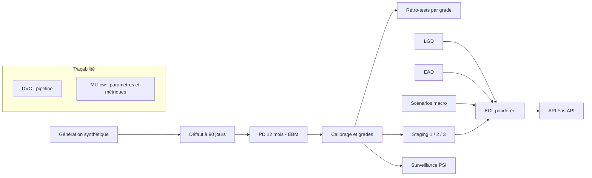

# credit-scoring — Provisionnement IFRS 9 et scoring de risque de crédit

Chaîne de calcul de la perte de crédit attendue (ECL) pour un portefeuille de crédit de détail simulé, avec une PD par Explainable Boosting Machine et une API de scoring.

## Problème résolu

Le provisionnement IFRS 9 demande une PD non biaisée, une LGD, une EAD, un classement par stage et des scénarios macro pondérés. Le dépôt assemble ces briques dans un pipeline reproductible (DVC), tracé (MLflow), avec des garde-fous contre la fuite de données et l'usage de variables de tiers, puis expose le résultat par une API qui renvoie aussi l'explication terme à terme de la PD.

Les données sont **synthétiques** (générateur inclus, période 2016-2024). Aucun niveau de performance ne se transpose à un portefeuille réel. Le pipeline est aligné sur des exigences IFRS 9 et Bâle III ; il n'est ni validé par un superviseur, ni « conforme IRB ». Voir [`docs/regulatory_mapping.md`](docs/regulatory_mapping.md).

## Fonctionnalités

- Générateur de données synthétiques : emprunteurs, employeurs, commerçants, prêts, transactions, macro, découpages temporels (apprentissage, validation, test, hors période).
- Variables relationnelles de graphe (NetworkX) calculées à partir des transactions ; elles sont exclues des modèles éligibles car non point-in-time.
- Définition du défaut à 90 jours, période de guérison paramétrable.
- PD à 12 mois par EBM avec contraintes de monotonie, recherche aléatoire d'hyperparamètres par validation croisée temporelle, comparaison avec régression logistique et LightGBM.
- Calibrage (Platt, isotonique), grades de risque, rétro-tests par grade (binomial, Vasicek, Jeffreys, Hosmer-Lemeshow).
- LGD (EBM de régression), EAD par amortissement contractuel, staging, trois scénarios macro pondérés, ECL à 12 mois, durée de vie ou défaut, vue prudentielle indicative.
- Surveillance de la dérive (PSI sur variables et score).
- API FastAPI : `/health`, `/score`, `/score_batch`, `/model_card`, `/metrics` (Prometheus).
- Environnement Docker Compose : pipeline, API, MLflow, Prometheus, Grafana.

## Architecture



Les étapes DVC (`dvc.yaml`) : `generate`, `tune_ebm`, `train_pd`, `calibrate`, `backtest`, `lgd_ead`, `ecl`, `monitoring`, `figures`, `notebook`. Tous les paramètres sont dans `params.yaml`.

## Stack technique

| Domaine | Outils |
|---|---|
| Langage | Python 3.12+ |
| Modélisation | interpret (EBM), scikit-learn, LightGBM, SciPy, NumPy, pandas |
| Graphe | NetworkX |
| Pipeline et suivi | DVC, MLflow |
| API et supervision | FastAPI, Uvicorn, prometheus-client, Prometheus, Grafana |
| Qualité | pytest, ruff, GitHub Actions |
| Conteneurs | Docker, Docker Compose |

## Installation

```bash
git clone <url-du-depot> credit-scoring && cd credit-scoring
python -m venv .venv && source .venv/bin/activate      # Windows : .venv\Scripts\activate
pip install -e ".[dev]"
cp .env.example .env                                    # valeurs factices à adapter
```

## Usage

Les données, modèles et sorties ne sont pas versionnés : ils se régénèrent.

```bash
dvc repro                                               # génère les données puis exécute toutes les étapes
uvicorn credit_risk_graph.api.main:app --port 8000      # API (nécessite artifacts/ifrs9/models/ecl_engine.joblib)
mlflow ui --backend-store-uri sqlite:///mlruns/mlflow.db
```

Exemple d'appel (les champs obligatoires sont listés dans `REQUIRED_FIELDS`, `src/credit_risk_graph/api/main.py`) :

```bash
curl -X POST http://localhost:8000/score -H "Content-Type: application/json" \
  -d '{"features": {"current_dpd": 10, "restructured_flag": 0, "origination_pd": 0.05, "outstanding_balance": 500000,
       "interest_rate": 0.14, "installment_amount": 25000, "remaining_term_months": 24, "macro_stress": 0.2,
       "sector_stress": 0.22, "collateral_type": "Aucun", "product_type": "PretPersonnel", "region": "Lome"}}'
```

Avec Docker : `docker compose run --rm pipeline`, puis `GRAFANA_ADMIN_PASSWORD=<mot de passe> docker compose up -d api mlflow prometheus grafana`.

## Structure du dépôt

```text
src/credit_risk_graph/
  data/, features/    génération synthétique, nettoyage, variables de graphe
  ifrs9/              défaut, PD, calibrage, backtesting, LGD, EAD, staging, scénarios, ECL
    stages/           une étape DVC par fichier
  monitoring/         PSI, métriques Prometheus
  api/                API de scoring
  utils/              entrées-sorties, journalisation, empreintes
scripts/              point d'entrée de génération, construction du notebook
tests/                formules ECL, rétro-tests, gouvernance, anti-fuite, API
docs/                 cartographie réglementaire
docker/               configuration Prometheus et Grafana
params.yaml, dvc.yaml paramètres et pipeline
```

## Tests

```bash
pytest tests
ruff check src tests scripts
```

Les tests utilisent des répertoires temporaires (variables `CREDIT_RISK_DATA_DIR` et `CREDIT_RISK_ARTIFACTS_DIR`) et ne dépendent pas des sorties du pipeline.

## Limites connues

- Données synthétiques ; taux de défaut simulé sans rapport avec un portefeuille réel.
- Scénarios macro et pondérations : hypothèses de démonstration ; un seul indice de stress.
- LGD apprise sur une cible synthétique déterministe : sa précision n'a pas de valeur probante.
- Pas de période de probation entre stages, pas d'actualisation des recouvrements en Stage 3, pas de remboursements anticipés.
- Vue prudentielle indicative : pas d'actifs pondérés.
- Région, taille du ménage et type d'emploi peuvent servir de proxys : une revue d'équité serait nécessaire avant tout usage réel.
- Le dépôt ne contient ni données ni modèles entraînés ; les résultats sont à produire par `dvc repro`.

## Licence

Licence : tous droits réservés. Voir [`LICENSE`](LICENSE).

## Contact

Jean-Paul ADOGLI — GitHub : [Jean-Paul15](https://github.com/Jean-Paul15)
